# PLCedi

**ラダー回路・操作盤・サーボ設定と、Z世代向け教育機能付き。AI支援で、回路の作成から機械なしの動作確認までを1つの画面で。**

PLCedi は、制御エンジニアが「回路を書く → 操作盤を作る → 動きを確かめる」を1つの画面で行うための Windows アプリです。目標は、**制御エンジニアの開発工数を 50% 削減**することです（いまの試算は 35%〜56%、中央 46%。根拠は下の「開発工数 50% 削減の考え方」）。

3DCAD と連携する [MLR-SIM](https://github.com/evoaimaster-cyber/MLR-SIM) のモジュールとしての連携も準備中です。

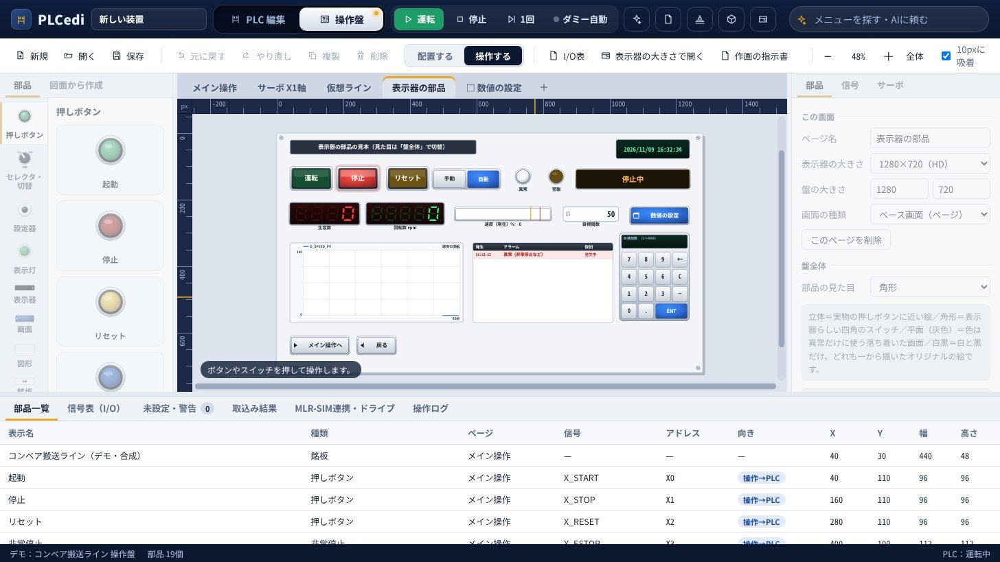

## なぜつくるのか

- 立上げにかかる時間のおよそ3分の2は、制御ソフトの誤りを直すことに使われている、という報告があります［1］。制御ソフトは、機械がそろって組み上がったあとでないと、まとめて確かめられないためです。
- 立上げの段階で直すと、設計の段階で直すより最大で100倍の費用がかかる、と報告する会社もあります［6］。
- 回路は PLC の開発ツール、操作盤は表示器の作画ツール、I/O表は Excel と、別々に作ることが多く、信号の名前やアドレスを何度も書き写して照合します。

PLCedi は、これらを同じ信号（I/O表）でつなぎ、機械ができる前にパソコンの中で回路を動かして確かめられるようにします。

## しくみ：1つの画面の中でつながる

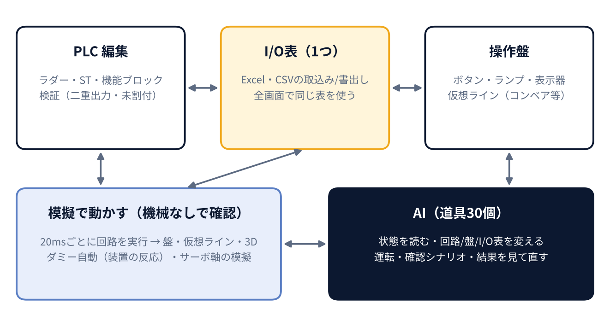

| 構成 | 役割 |
| --- | --- |
| PLC 編集 | ラダー・ST・機能ブロックの作成と検証（二重出力・未宣言・型の違い・I/O表の割付漏れ） |
| I/O表（1つ） | Excel・CSV の取込みと書出し。PLC 編集でも操作盤でも同じ表を使う |
| 操作盤 | ボタン・ランプ・表示器・テンキーなどを置き、I/O表の信号を選ぶだけで回路とつながる |
| 模擬で動かす | 20ms ごとに回路を実行し、操作盤・仮想ライン・3D・ダミー自動（装置の反応）・サーボ軸の模擬とつなぐ |
| AI（道具30個） | 状態を読む・回路や盤や I/O表を変える・運転する・確認シナリオを流す。人の画面操作と同じ処理 |

## 主な機能

### PLC 編集（ラダー・ST・機能ブロック）

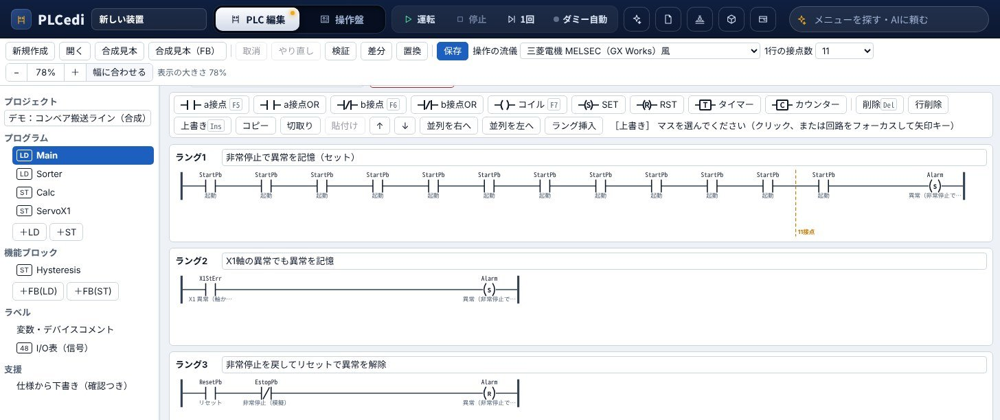

- ラダー（a接点・b接点・コイル・SET/RST・タイマー・カウンター・途中からの並列）と ST、機能ブロック。
- キー操作は三菱電機 MELSEC（GX Works）風が基本。使い慣れたその他のメーカーの操作も追加予定。
- Ctrl＋マウスホイールで表示の大きさを 50〜200% に変更。「幅に合わせる」で横に長い回路も1画面に。
- 「1行の接点数」（9・11・13・17・21）を超えた行に点線を引き、検証で知らせる。
- プログラムを右クリックして、名前の変更（使っている所も一緒に変わる）・コピーして追加・アクティブ／非アクティブ・削除。

### I/O表（信号表）

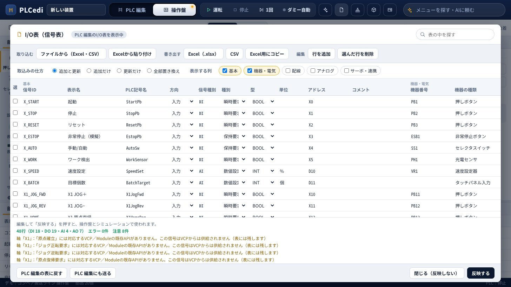

- Excel（.xlsx）・CSV・Excel からの貼り付けで取込み。「追加と更新／追加だけ／更新だけ／全部置き換え」を選べる。
- Excel への書出しは、見出しの固定・フィルター・選択リスト付き。
- 機器番号・a/b 接点・配線・アナログの範囲・サーボの軸など、電気設計で使う列もそろえている。

### 操作盤（HMI）

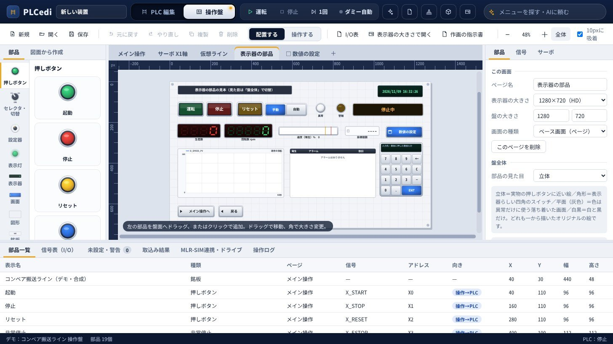

- 押しボタン・セレクター・ランプ・表示器・メーターに加え、7セグ表示・テンキー・数値入力・棒グラフ・トレンド・アラーム一覧・時計・画面切替ボタン・図形。
- 表示器の大きさ（640×480〜1920×1080）をページごとに選び、実物と同じ大きさの画面を別ウィンドウに出せる。
- 指でのタッチはマウスのクリックと同じに扱う。タッチパネルのパソコンでそのまま操作できる。
- 「作画の指示書」で、画面一覧と部品一覧を Excel に書き出し。各社の作画ツールで本番の画面を作るときの指示書になる。

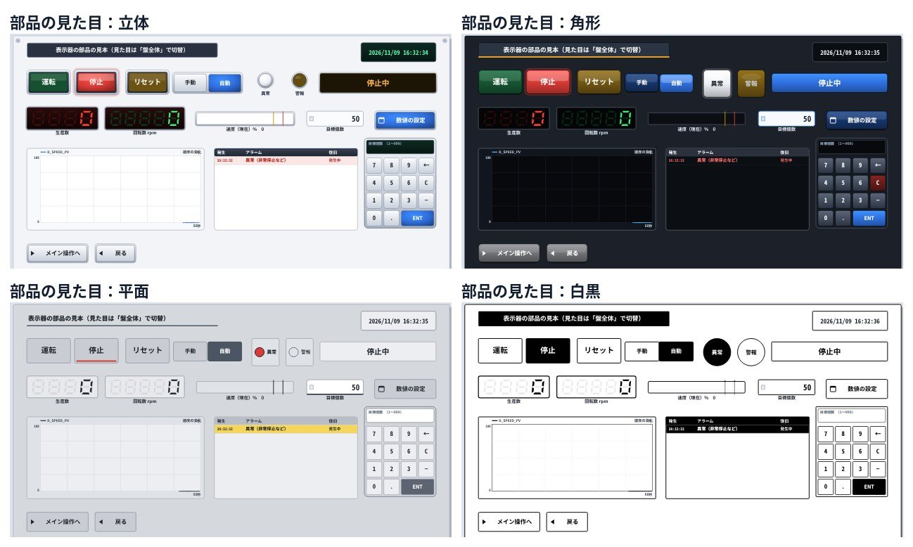

- 部品の見た目は、立体・角形・平面・白黒の4つ。各社の表示器の雰囲気に近づけた、オリジナルの絵です。
- ボタンの動きは「押している間ON」「押すたび切替」「ONにする」「OFFにする」「数値を書く」。ランプは点滅や、値による色の切替。

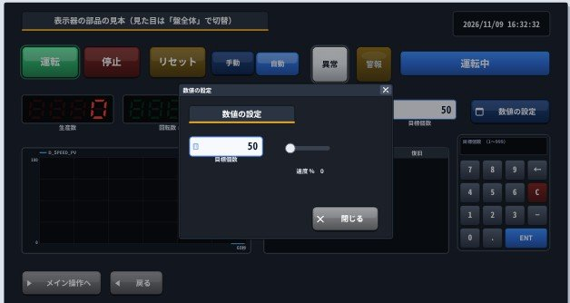

- 数値入力の部品を押すとテンキーが開き、範囲と小数の桁を確かめる。
- 「ウィンドウ画面」で、ほかの画面の上に小さく開く画面を作れる。条件で部品を出したり隠したりもできる。

### 機械の代わりに動かす

| 仮想ライン | 3D表示 |
| --- | --- |
| 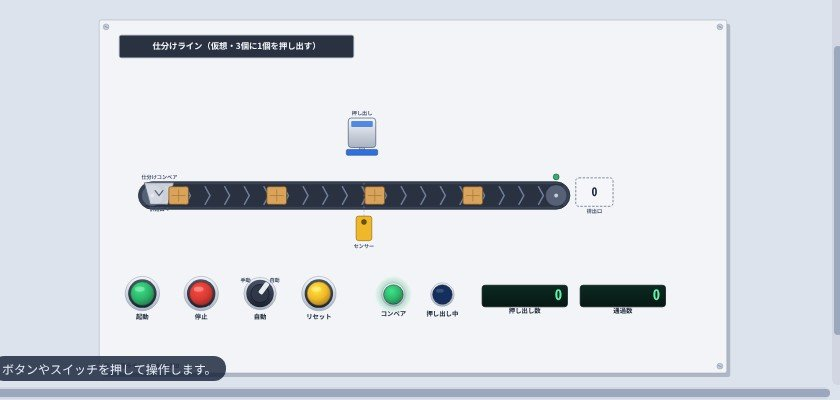 | 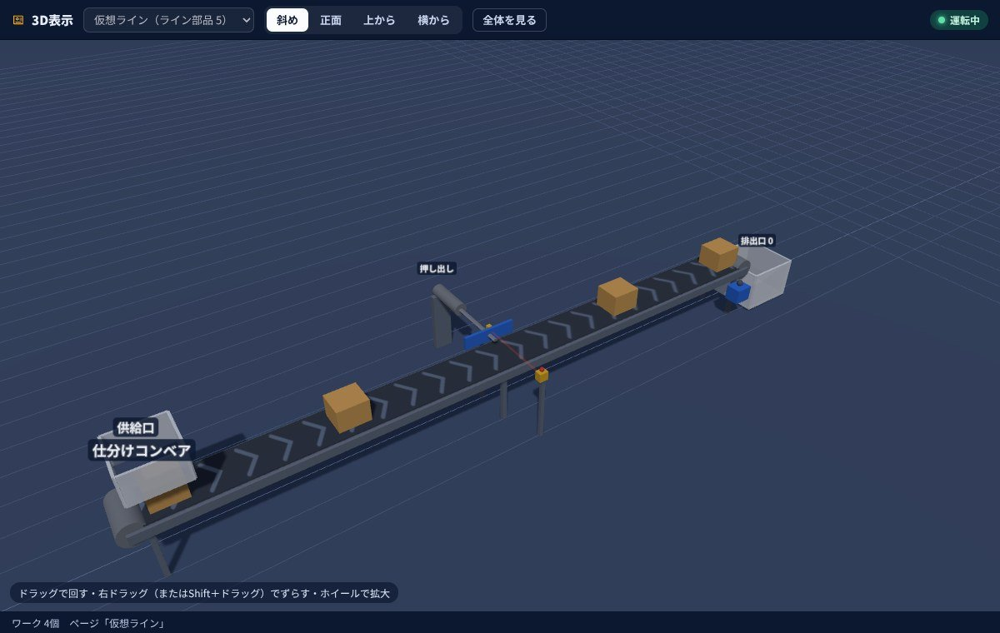 |
| コンベア・ワーク供給口・センサー・シリンダー・ストッパー・排出口を盤に置き、PLC の出力で動かして、センサーや前進端の信号を入力へ返す | 仮想ラインを自動で3Dに組み立てて表示。視点は斜め・正面・上から・横から |

| ダミー自動（装置の反応の模擬） | モーション設定（サーボ軸） |
| --- | --- |
| 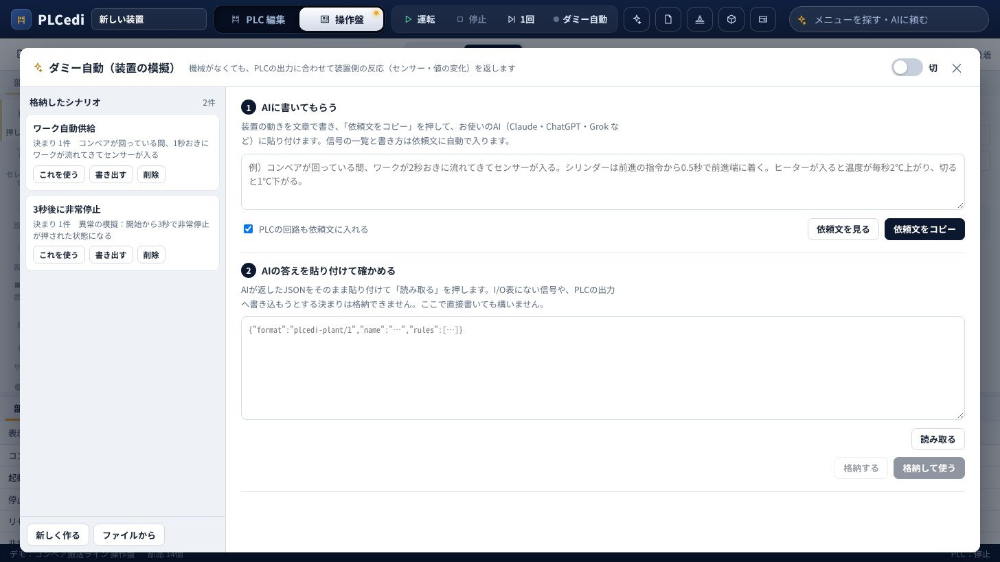 | 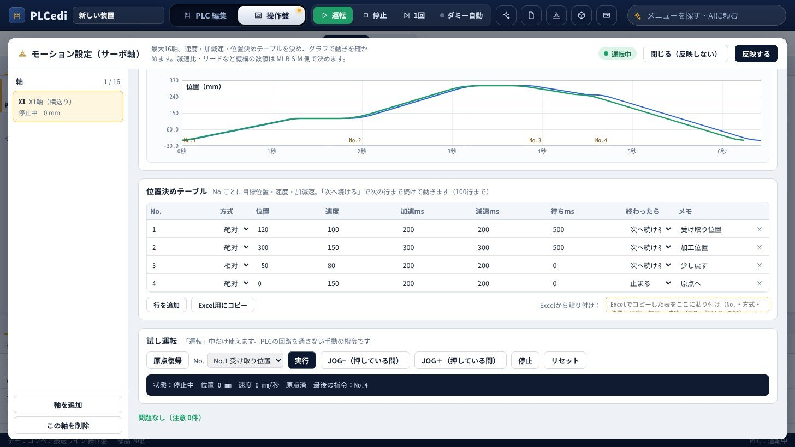 |
| 「遅れて反応」「くり返しパルス」「値を増減」「値を写す」「時刻で1回」の決まりで、装置側の反応を PLC の入力へ返す | 最大16軸。速度・加減速・JOG・原点復帰・ソフトリミット・位置決めテーブル（100行）と、計画と模擬の動きのグラフ |

### デモと確認シナリオの一括実行

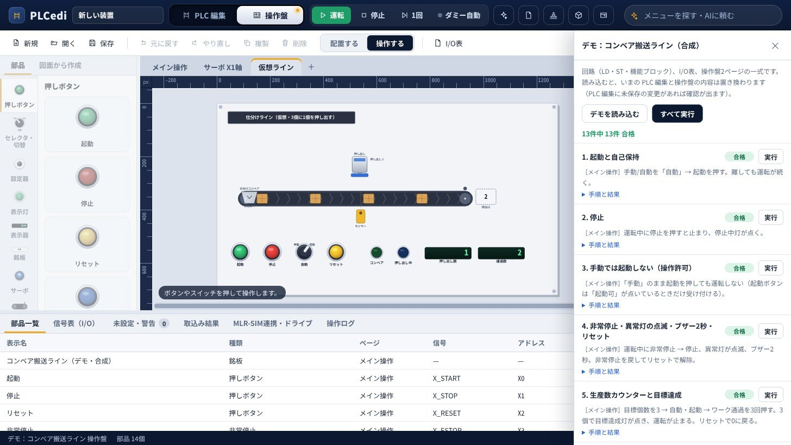

コンベア搬送ラインのデモ（回路・I/O表・操作盤・ダミー自動・仮想ライン・サーボ軸）と、確認シナリオ（ボタンを押す → 待つ → ランプを確かめる）が入っています。ボタン1つで13件をまとめて流し、合否を確かめられます。

## Z世代向けの教育機能

Z世代をはじめ、PLCを学び始める方が、自分で回路を書いて動かしながら学べます。

- ミッション形式で、基本の接点や自己保持から、タイマーや搬送ラインの制御へ進みます。
- 操作盤のボタンを押すと、自分の回路で仮想ラインが動きます。3D表示でも動きを確認できます。
- 確認シナリオで動作を確かめ、詰まったときはお手本の回路や用語の説明を参照できます。

## AI と連動して進める（開発中）

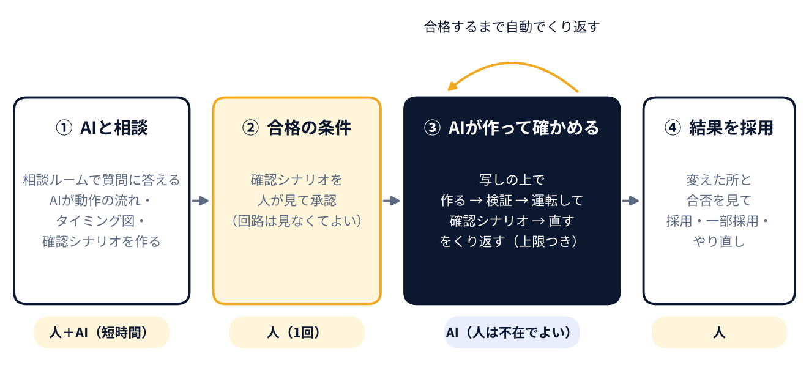

いまは、AI が30個の道具（読むだけ13・変える17）を使えます。やり取りはコピーと貼り付けで行い、変える操作は1つずつ人が確認します。

次の段階では、AI と直接つなぎ、エンジニアがそばにいない間も AI が作業を進められるようにします。

1. **相談ルーム**：AI が聞き役になり、I/O表と今の回路を読んだうえで、足りないことだけを質問します。起動・停止・非常停止・原点復帰・手動と自動・異常・インターロック・停電復帰など、抜けやすい項目を必ず確かめます。
2. **合格の条件**：相談の結果から AI が「動作の流れ」「タイミング図」「確認シナリオ」を作り、人が1回だけ承認します。
3. **AI が作って確かめる**：元のプロジェクトの写しの上で、作る → 検証 → 運転して確認シナリオ → 直す、を合格するまでくり返します。回数・時間・費用の上限つき。
4. **結果を採用**：変えた所、合否、AI が判断した点をまとめて見て、採用・一部採用・やり直しを選びます。

使う AI は、Claude・ChatGPT・Gemini・Grok と、パソコンの中で動く AI（社外に出さない案件向け）から選べるようにします。検証して直すくり返しを入れると、AI が書く PLC の回路の成功率が上がる、という研究があります（47% → 72%）［7］。

## 開発工数 50% 削減の考え方（試算）

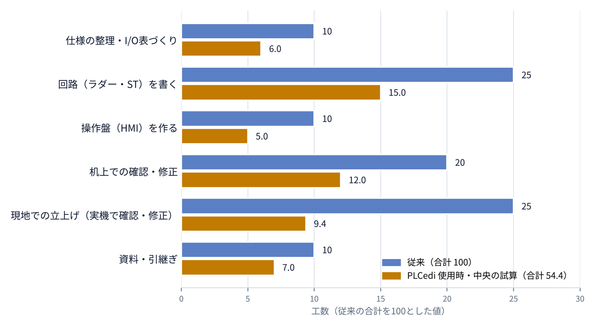

| 作業 | 従来の割合 | 減る割合 | PLCedi で効く機能 |
| --- | ---: | ---: | --- |
| 仕様の整理・I/O表づくり | 10 | 30〜50% | I/O表 |
| 回路（ラダー・ST）を書く | 25 | 30〜50% | PLC 編集・AI |
| 操作盤（HMI）を作る | 10 | 40〜60% | 操作盤 |
| 机上での確認・修正 | 20 | 30〜50% | ダミー自動・確認シナリオ |
| 現地での立上げ（実機で確認・修正） | 25 | 50〜75% | 仮想ライン・3D・モーション |
| 資料・引継ぎ | 10 | 20〜40% | I/O表の書出し |
| **合計** | **100** | **35〜56%（中央 46%）** | **目標 50%** |

「従来の割合」は中規模の装置1台を想定した例です。「現地での立上げ」の減り方は、模擬で先に確かめる方法の研究と事例（70〜75%減）［2］［3］を根拠に、PLCedi の模擬が簡易であることを考えて幅を取りました。ほかの作業の減る割合は、まだ実際の案件で測っていない見込みの値です。

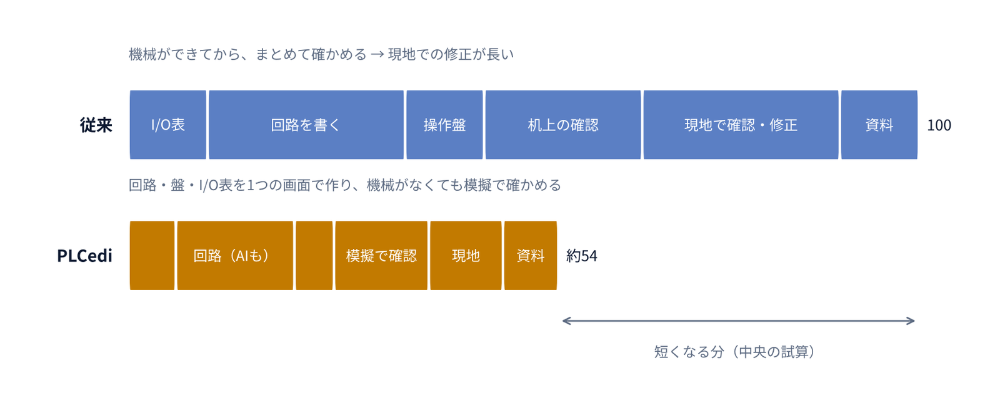

## 他社・他のアプリとの違い

PLC の開発では、各社の開発ツール、表示器の作画ツール、模擬のツールを組み合わせて使うのが一般的です。2026年には各社が AI の機能を相次いで出しています（2026年11月時点の公開情報）。

| 種類 | 主な例 | 得意なこと | PLCedi との違い |
| --- | --- | --- | --- |
| 各社の PLC 開発ツール | 三菱電機 GX Works3、シーメンス TIA Portal、キーエンス KV STUDIO、オムロン Sysmac Studio、ロックウェル Studio 5000 など | 実機への書込み、すべての命令、オンラインでの監視と保守 | PLCedi は実機に書き込めません。メーカーをまたいで、回路・I/O表・操作盤・模擬を1つの画面で作って確かめる「前段」を受け持ちます |
| 各社ツールの AI 機能 | シーメンス Engineering Copilot TIA［8］、ロックウェル FactoryTalk Design Studio Copilot［9］、ベッコフ TwinCAT CoAgent［10］、キーエンス KV Intelligence（2026年11月16日発売）［12］。三菱電機はラダー生成 AI を開発中［13］、オムロンは Automation Teams を2026年度中に投入予定［14］ | 自社ツールの中で、文章から回路を作る・説明する・試験を作る | 対象はそのメーカーの PLC とツールに限られます。PLCedi は、盤と装置の模擬まで含めて、確認シナリオで「装置の動き」を確かめるところまで AI がくり返す形を目指します |
| メーカー共通の開発環境 | CODESYS（AI が開発環境を操作できる MCP サーバー）［11］ | IEC 61131-3 の共通の書き方。AI が回路を作り、コンパイルの結果を見て直す流れ | PLCedi は操作盤と装置の模擬を同じ画面に持ち、動きの確認までを1つの流れにします |
| 模擬・仮想立上げのツール | Factory I/O［15］、シーメンス PLCSIM・Process Simulate、ロックウェル Emulate3D、三菱電機 MELSOFT Gemini・Mirror［16］ | 3D と物理の計算を使った本格的な装置の模擬 | PLCedi の模擬は簡易ですが、回路・盤と同じ画面ですぐに動かせます。3DCAD との本格的な連携は MLR-SIM で準備中です |
| 表示器の作画ツール | 各社の作画ソフト | 本番の画面の作成と、表示器への書込み | PLCedi の操作盤は試作と確認用です。「作画の指示書」（Excel）で本番の作画へ引き継ぎます |

**PLCedi が違うところ**

- 回路・I/O表・操作盤・模擬が、同じ信号で1つの画面につながる。
- AI を選べる。シーメンスとロックウェルの AI 機能はマイクロソフトと組んで開発されたもの［9］［17］、ベッコフの CoAgent はいろいろな AI と組み合わせられるとしています［10］。PLCedi は Claude・ChatGPT・Gemini・Grok・パソコンの中の AI から選ぶ形にします（開発中）。
- 人が承認した確認シナリオで装置の動きを模擬し、合格するまで AI が直すことを目指す（開発中）。
- 特定の PLC メーカーに決まっていない。

**PLCedi が及ばないところ**

- 実機の PLC へ書き込めません。本番の回路は、各社の開発ツールで仕上げます。
- 各社の開発ツールへの回路の書出しは、まだありません。
- 命令と機能は基本的なものです（補間・カム・同期などは未対応）。
- 模擬は簡易です。3D と物理の計算を使った本格的な模擬は、MLR-SIM との連携で準備中です。
- 実際の案件での実績はこれからです。安全規格の認証はありません。

PLCedi は各社のツールの置き換えではなく、各社のツールに渡す前の「設計と確かめ」を、AI と一緒に短く済ませるためのアプリです。

## 現在の段階

いまの版（統合版 候補 int1k）でできることと、これから直す・加える予定です。

| 項目 | 状態 |
| --- | --- |
| ラダー・ST・機能ブロック、検証、模擬での実行 | できる |
| I/O表の取込み・書出しと全画面での共有 | できる |
| 操作盤（表示器の部品・テンキー・ウィンドウ画面・4つの見た目・作画の指示書） | できる |
| 仮想ライン・3D・ダミー自動・サーボ軸の模擬（最大16軸） | できる |
| AI の道具30個（コピーと貼り付け、変更は人が確認） | できる |
| Z世代向けの教育機能（ミッション・お手本・用語の説明・動作確認） | できる |
| 1台のモニターで、PLC 編集の右に操作盤を並べて運転テスト | 作成中 |
| 2台のモニター（操作盤を2台目に大きく開く）、窓の位置を覚える、縦長のモニター | 予定 |
| AI との直接の接続、相談ルーム、AI が作って確かめるくり返しと結果の採用 | 予定 |
| 仕事をためる・並行・通知、ほかのメーカーの操作の流儀 | 予定 |
| 3DCAD との連携（MLR-SIM） | 準備中 |
| 長い行の折り返し表示、自分で作った部品の登録、各社ツールへの書出し | 検討中 |
| 実機の PLC との通信・書込み | 対象外（この版はソフトウェアだけの模擬） |

## 動作環境と安全

- Windows のパソコンで動きます。お使いいただく際はインストールが必要です。
- アプリ自体は外部との通信はしません。ファイル以外への読み込みはアプリが止めます。
- AI との直接の接続（開発中）を使うときだけ、選んだ AI の宛先に限って通信します。パソコンの中で動く AI を選べば、外へは出ません。
- 3D表示には three.js（MIT License）を同梱しています。

## 資料

- [詳細説明：PLCedi PR v1r2（PDF）](https://bizai-evo.com/pdf/PLCedi_PR_v1r2.pdf)
- [スライド説明（PDF）](https://bizai-evo.com/pdf/PLCedi_Slide.pdf)
- [リポジトリ内の製品紹介資料（PDF）](docs/PLCedi_製品紹介資料.pdf)

このリポジトリでは、PLCedi の目的・機能・これからの予定を紹介します。

## 先行利用の募集・お問い合わせ

PLCedi を実際の案件で試していただける会社・個人の方を募集しています。作業ごとの時間や現地での立上げ日数などを一緒に記録し、開発工数がどれだけ減るかを確かめます。

ご質問・ご相談もこちらへどうぞ。

- メール：[info@bizai-evo.com](mailto:info@bizai-evo.com)

## 出典

1. Liu Z, Diedrich C, Suchold N. Virtual Commissioning of Automated Systems. INTECH, 2012（Visual Components のブログで引用） https://www.visualcomponents.com/blog/increasing-control-software-quality-with-virtual-commissioning/
2. Reinhart G, Wünsch G. Economic application of virtual commissioning to mechatronic production systems. Production Engineering 1(4):371–379, 2007（同ブログで引用）
3. Siemens. Wipro PARI reduces commissioning time by 70% https://blogs.sw.siemens.com/tecnomatix/wipro-pari-reduces-commissioning-time-by-70/
4. Siemens. Industrial Copilot の発表（2025年3月） https://iconnect007.com/article/144587/siemens-expands-industrial-copilot-with-new-generative-aipowered-maintenance-offering/144584/pcb
5. IFAC 2014 の論文：制御ソフト開発の時間の25〜30%が試験に使われる https://skoge.folk.ntnu.no/prost/proceedings/ifac2014/media/files/1238.pdf
6. Rockwell Automation のブログ：立上げ中の修正は、設計段階より最大100倍の費用 https://www.rockwellautomation.com/ja-jp/company/news/blogs/avoid-costly--last-minute-surprises-with-virtual-commissioning.html
7. Fakih M ほか. LLM4PLC（2024） https://sites.google.com/uci.edu/llm4plc/home
8. Siemens. Engineering Copilot TIA Standard https://www.siemens.com/de-ch/products/tia-portal/engineering-copilot-tia-standard
9. OEM Magazine. Rockwell Automation の FactoryTalk Design Studio に生成 AI の Copilot（マイクロソフトと共同開発） https://www.oemmagazine.org/engineering/automation/article/22927841/rockwell-automations-factorytalk-design-studio-adds-generative-ai-copilot
10. Beckhoff. Hannover Messe 2026：TwinCAT 3 CoAgent https://www.beckhoff.com/ct/default.aspx?id=3409
11. CODESYS. AI-supported Engineering at SPS 2026 https://www.codesys.com/landing-page-ai-sps-2026/
12. MONOist（2026年11月4日）：キーエンス「KV Intelligence」 https://monoist.itmedia.co.jp/mn/articles/2611/04/news044.html
13. MONOist（2026年3月）：三菱電機のラダー生成 AI https://monoist.itmedia.co.jp/mn/spv/2603/16/news017_2.html
14. MONOist（2026年3月4日）：オムロン「OMRON Automation Teams（仮称）」 https://monoist.itmedia.co.jp/mn/articles/2603/04/news024.html
15. Factory I/O Starter Edition https://factoryio.com/starter-edition
16. MONOist（2025年11月21日）：三菱電機 IIFES 2025、MELSOFT Gemini と MELSOFT Mirror https://monoist.itmedia.co.jp/mn/articles/2511/21/news068.html
17. icnweb（2024年）：シーメンスとマイクロソフトが Industrial Copilot を発表 https://icnweb.kr/2024/73489/hm24-siemens-unveils-generative-ai-powered-industrial-copilot/

製品名・会社名は、各社の商標または登録商標です。
